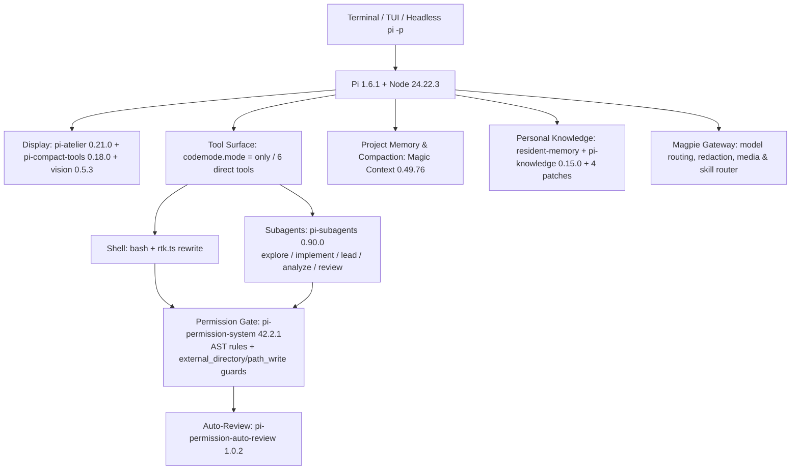

# <picture><source media="(prefers-color-scheme: light)" srcset="docs/assets/logo-light.svg"></picture> akis-pi

English | [简体中文](README.zh-CN.md) | [Interactive Architecture Map (GitHub Pages)](https://akir1n.github.io/akis-pi/)

A shareable, evidence-backed configuration bundle for the [Pi coding agent](https://pi.dev) by AkiyamaRin—designed so you can hand the repository to an AI agent to deploy step by step, and read the exact rationale and measurements behind every choice.

## Highlights

- **Minimal Tool Surface (`codemode: only`)**: Exposes only 6 direct tools to the model; the remaining 50+ tools stay inside Pi's QuickJS sandbox and are discovered on demand via `searchTools()` / `describeTool()`. Cut first-turn prompt overhead by ~45% and verified across 13 days of real production sessions (2,842 scripts, 3.48% failure rate, zero regression).
- **Two-Layer Permission Gate + Auto-Review**: Ships `@gotgenes/pi-permission-system` (bash AST decomposition, fine-grained command globs, `rtk` command-effect awareness, external-directory & sensitive-path guards) chained with `@mzwing/pi-permission-auto-review` (`codex` preset) so routine commands pass at 0 ms while risky actions are reviewed or escalated.
- **Role-Based Subagent Delegation**: 5 specialized roles (`explore`, `implement`, `lead`, `analyze`, `review`) decoupled from concrete model IDs—cheap execution model for bulk work, stronger heterogeneous model for analysis/review, and flagship model reserved for explicit `model:` overrides.
- **Layered, Isolated Memory**: Lightweight `RESIDENT.md` facts injected every turn, on-demand personal/note retrieval via patched `pi-knowledge`, and long-session compaction + project memory via Magic Context.
- **Magpie Gateway Integration**: Unified model routing, request redaction, image/video generation, anti-scrape `web_fetch` fallback, and routed skill/MCP discovery.

## Architecture Overview



## Prerequisites

| Requirement | Pinned / Tested Baseline | Notes |
| --- | --- | --- |
| Node.js | `24.22.3` | Avoid `24.19.0–24.21.x` (`better-sqlite3` GC `SIGABRT`, `nodejs/node#65446`). |
| Pi | `1.6.1` | Official managed installer or exact npm pin. |
| Git | Any modern version | Native Windows requires Git for Windows (Git Bash). |
| Magpie | Running locally | Required module for routing, media, fallback fetch, and `rtk`. |
| Python | `3.9+` | Only needed for the optional `pdf` module. |
| Models | Any OpenAI-compatible provider | At least one main/execution model and one stronger review model. |

## Platform Support

| Platform | Status | Modules | Notes |
| --- | --- | --- | --- |
| macOS arm64 | Verified | `core`, `magpie`, `memory`, `macos`, `pdf` | Reference platform; all 5 subagent roles and permission gates verified. |
| WSL2 (Ubuntu 24.04 x64) | Partial (`core`, `memory` verified) | `core`, `magpie`, `memory`, `pdf` | Recommended path on Windows; keep files under `/home`, not `/mnt/c`. |
| Native Windows x64 | Experimental | `core`, `magpie`, `memory`, `pdf` | Installer & probes passed; long-running TUI/desktop unverified. |
| Linux x64 glibc | Experimental | `core`, `magpie`, `memory`, `pdf` | Inferred from WSL2; no bare-metal run yet. |

## Quick Start (Hand to an AI Agent)

1. Give this repository to your coding agent and instruct it to follow [AGENTS.md](AGENTS.md) → [DEPLOY.md](DEPLOY.md) strictly without skipping steps.
2. Provide your model placeholders (`PROVIDER`, `MODEL`, `MODEL_EXEC`, `MODEL_REVIEW`, `MODEL_PLAN`, `MODEL_HISTORIAN`) and credential references (`$VAR` or macOS Keychain `!command`—never literal keys).
3. Require two verification outputs before accepting completion:
   - `node scripts/doctor.mjs --home "$HOME" --modules ...` returning **0 FAIL**;
   - Loopback stub check (`node scripts/deploy-check.mjs stub-requests`) confirming exact 6 direct tools and expected prompt injections.

## Modules

| Module | Contents | Recommendation | Docs |
| --- | --- | --- | --- |
| **core** | `settings.json`, `AGENTS.md`, `APPEND_SYSTEM.md`, 5 subagent roles, `compact-tools.json`, `pi-permission-system` + `pi-permission-auto-review` configs, `web-search.json`, `rtk.ts` | Required | [DEPLOY.md](DEPLOY.md) |
| **memory** | Magic Context `0.49.76`, `resident-memory.ts`, `RESIDENT.template.md`, `pi-knowledge` `0.15.0` + 4 patches (optional QML grammar) | Required | [modules/memory](modules/memory/README.md) |
| **magpie** | Magpie gateway extension, `mcp.json.example`, routing & redaction guide | Required | [modules/magpie](modules/magpie/README.md) |
| **macos** | `herdr-agent-state.ts`, `ego-gc.ts` (darwin only) | Required on macOS | [modules/macos](modules/macos/README.md) |
| **pdf** | Local PyMuPDF PDF → Markdown endpoint + launchd / systemd / Windows task adapters | Optional | [modules/pdf](modules/pdf/README.md) |

## Boundaries & Honest Limits

- **Primary maintenance target**: Guaranteed and actively tested on **macOS arm64**; WSL2 / Windows / Linux follow the support table above.
- **Permission gate defaults**: `settings.json` sets `defaultProjectTrust: "always"` and relies on `pi-permission-system` + `pi-permission-auto-review` for command/path gating. Review `config/pi-permission-system/config.json` and `config/pi-permission-auto-review/config.json` to match your own sensitive paths before enabling auto-review.
- **External CLIs**: `agent-browser` CLI (`>=0.44.0` for `pi-agent-browser-native@0.9.42`) and `rtk` (`>=1.1.0`) are installed separately.
- **Scope**: This repository delivers a clean, repeatable initial setup. Track ongoing upgrades and rollback snapshots in your own local maintenance repo using [docs/upgrade.md](docs/upgrade.md).

## Repository Layout

```text
akis-pi/
├── AGENTS.md           Deployment contract for the deploying AI
├── DEPLOY.md           Step-by-step POSIX / PowerShell / WSL2 deployment guide
├── manifest.json       Pinned versions, module ownership & platform tags
├── config/             Parameterised templates (settings, rules, roles, permission configs)
├── extensions/         rtk.ts (bash output compression & rewrite hook)
├── skills/             pi-workflow-notes (multi-step workflow guidance)
├── modules/            memory, macos, pdf, magpie modules & patches
├── scripts/            render.mjs (dry-run + backup), doctor.mjs, deploy-check.mjs, tests
├── tests/              Windows VM and WSL2 verification drivers
└── docs/
    ├── index.html      Interactive architecture map (GitHub Pages)
    ├── reference.md    Version pins, dependency rationale & platform notes
    ├── decisions.md    Measured benchmarks & architectural trade-offs
    └── upgrade.md      Upgrade order, silent touchpoints & rollback handbook
```

## References & Acknowledgements

- **Core ecosystem**: Built on the [Pi coding agent](https://pi.dev) and [Magpie](https://github.com/yetone/magpie), integrating community packages including [`@gotgenes/pi-permission-system`](https://github.com/gotgenes/pi-packages/tree/main/packages/pi-permission-system), [`@mzwing/pi-permission-auto-review`](https://github.com/mzwing/pi-packages/tree/main/packages/pi-permission-auto-review), [`pi-subagents`](https://github.com/nicobailon/pi-subagents), [`@cortexkit/pi-magic-context`](https://www.npmjs.com/package/@cortexkit/pi-magic-context), [`pi-knowledge`](https://github.com/nczz/pi-knowledge), [`pi-atelier`](https://github.com/michaelmjhhhh/pi-atelier), [`pi-compact-tools`](https://github.com/nedleeds/pi-compact-tools), [`pi-web-access`](https://github.com/nicobailon/pi-web-access), and the other upstream projects catalogued in [docs/reference.md](docs/reference.md) and the [Architecture Map](https://akir1n.github.io/akis-pi/).
- **Design references**: Several workflow patterns in this bundle (automated permission review presets, long-session compaction, and the optional companion single-track PTY execution model) draw inspiration from open-source CLI coding agents and community engineering discussions.
- **Affiliation & licensing notice**: This repository is an independent personal configuration bundle and is not affiliated with or endorsed by Pi, OpenAI, or any upstream plugin author. All third-party packages and patches remain subject to their respective upstream licenses.
