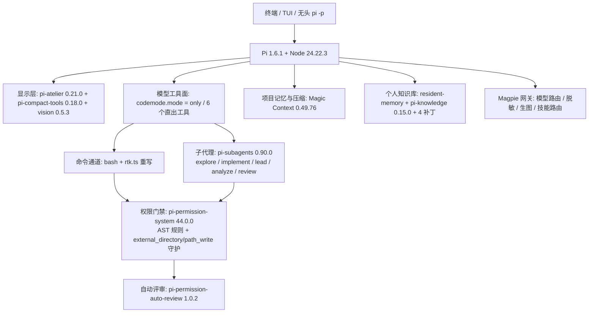

# <picture><source media="(prefers-color-scheme: light)" srcset="docs/assets/logo-light.svg"></picture> akis-pi

[English](README.md) | 简体中文 | [交互式架构图谱（GitHub Pages）](https://akir1n.github.io/akis-pi/)

AkiyamaRin 的自用 [Pi coding agent](https://pi.dev) 配置分享包：既能直接交给 AI 按步骤部署并验收，也完整记录了每项配置取舍背后的实测数据与边界。

## 核心特色

- **极简模型工具面（`codemode: only`）**：模型顶层仅直接可见 6 个工具，其余 50+ 工具收进 Pi 的 QuickJS 沙箱按需发现（`searchTools` / `describeTool`）。首轮固定提示词压缩约 45%，并经 13 天生产真实会话复查（2,842 次脚本，失败率 3.48%，无退步信号）。
- **双层权限门禁 + 自动审批**：内置 `@gotgenes/pi-permission-system`（bash AST 解析、精细命令白名单/黑名单、`rtk` 只读命令识别、外部目录与敏感路径守护）联动 `@mzwing/pi-permission-auto-review`（`codex` preset），安全命令 0 ms 放行，高危操作自动审核或交由人工确认。
- **5 角色子代理分工**：`explore` / `implement` / `lead` / `analyze` / `review` 与具体模型解耦——执行用高性价比模型，分析与验收用更强的异构模型，最强模型保留给显式 `model:` 覆盖。
- **分层隔离记忆**：每轮仅注入精简的 `RESIDENT.md` 常驻事实；个人与笔记通过带 4 个补丁的 `pi-knowledge` 按需检索；长会话压缩与项目记忆交给 Magic Context。
- **Magpie 网关协同**：统一承载模型路由、请求脱敏、生图/生视频、反爬抓取兜底及技能/MCP 路由。

## 架构总览

## 前置条件

| 项 | 基准版本 | 说明 |
| --- | --- | --- |
| Node.js | `24.22.3` | 避开 `24.19.0–24.21.x`（`better-sqlite3` GC `SIGABRT`，`nodejs/node#65446`）。 |
| Pi | `1.6.1` | 官方 managed 安装器或按 npm 精确复现。 |
| Git | 现代版本 | 原生 Windows 必须装 Git for Windows（Git Bash）。 |
| Magpie | 本地运行 | 必装：负责模型路由、脱敏、媒体生成、抓取兜底与 `rtk`。 |
| Python | `3.9+` | 仅可选 `pdf` 模块需要。 |
| 模型 | 任意 OpenAI 兼容供应商 | 至少准备主力/执行模型与更强的复核模型。 |

## 平台支持

| 平台 | 状态 | 可用模块 | 说明 |
| --- | --- | --- | --- |
| macOS arm64 | 已实测 | `core`、`magpie`、`memory`、`macos`、`pdf` | 基准平台，5 角色与双层权限门禁均已实测。 |
| WSL2（Ubuntu 24.04 x64） | `core`/`memory` 已实测 | `core`、`magpie`、`memory`、`pdf` | Windows 用户默认推荐；文件留在 `/home`，不要放 `/mnt/c`。 |
| 原生 Windows x64 | 试验 | `core`、`magpie`、`memory`、`pdf` | 安装与探针通过；长时间 TUI 与桌面能力未验。 |
| Linux x64 glibc | 试验 | `core`、`magpie`、`memory`、`pdf` | 由 WSL2 推断，无原生实机记录。 |

## 快速开始（交给 AI 部署）

1. 把本仓库交给你的 AI，让它严格按 [AGENTS.md](AGENTS.md) → [DEPLOY.md](DEPLOY.md) 逐步执行，不要跳步。
2. 一次性告知你的模型占位符（`PROVIDER`、`MODEL`、`MODEL_EXEC`、`MODEL_REVIEW`、`MODEL_PLAN`、`MODEL_HISTORIAN`）与凭据引用方式（`$VAR` 或 macOS Keychain `!command`，严禁明文 Key）。
3. 交付前必须核对两项实测输出：
   - `node scripts/doctor.mjs --home "$HOME" --modules ...` 报 **0 FAIL**；
   - 回环验收 `node scripts/deploy-check.mjs stub-requests` 确认 6 个直接工具集合准确且常驻提示词已注入。

## 模块说明

| 模块 | 内容 | 安装建议 | 详细文档 |
| --- | --- | --- | --- |
| **core** | `settings.json`、`AGENTS.md`、`APPEND_SYSTEM.md`、5 个子代理角色、`compact-tools.json`、`pi-permission-system` 与 `pi-permission-auto-review` 配置、`web-search.json`、`rtk.ts` | 必装 | [DEPLOY.md](DEPLOY.md) |
| **memory** | Magic Context `0.49.76`、`resident-memory.ts`、`RESIDENT.template.md`、`pi-knowledge` `0.15.0` + 4 补丁（QML 可选） | 必装 | [modules/memory](modules/memory/README.md) |
| **magpie** | Magpie 网关扩展、`mcp.json.example`、路由与脱敏说明 | 必装 | [modules/magpie](modules/magpie/README.md) |
| **macos** | `herdr-agent-state.ts`、`herdr-question-blocked.ts`、`ego-gc.ts`（仅 darwin） | macOS 必装 | [modules/macos](modules/macos/README.md) |
| **pdf** | 本地 PyMuPDF PDF → Markdown 端点及各平台后台服务适配 | 可选 | [modules/pdf](modules/pdf/README.md) |

## 边界与限制

- **维护范围**：仅承诺在 **macOS arm64** 上跟进与验证，其它平台按上表支持级别使用。
- **权限门禁自查**：`settings.json` 默认 `defaultProjectTrust: "always"`，安全边界由 `pi-permission-system` 与 `pi-permission-auto-review` 承担；启用自动审批前请审阅 `config/pi-permission-system/config.json` 与 `config/pi-permission-auto-review/config.json` 中的路径规则。
- **外部 CLI 需单独安装**：`agent-browser` CLI（`pi-agent-browser-native@0.9.42` 要求 `≥0.44.0`）与 `rtk`（`≥1.1.0`）不在 npm 插件包内。
- **定位边界**：本仓库负责初始可复现配置；装完后的持续升级与快照回滚建议放到独立的本地维护项目中，参考 [docs/upgrade.md](docs/upgrade.md)。

## 参考与致谢

- **上游生态**：本配置包构建于 [Pi coding agent](https://pi.dev) 与 [Magpie](https://github.com/yetone/magpie) 之上，组合了 [`@gotgenes/pi-permission-system`](https://github.com/gotgenes/pi-packages/tree/main/packages/pi-permission-system)、[`@mzwing/pi-permission-auto-review`](https://github.com/mzwing/pi-packages/tree/main/packages/pi-permission-auto-review)、[`pi-subagents`](https://github.com/nicobailon/pi-subagents)、[`@cortexkit/pi-magic-context`](https://www.npmjs.com/package/@cortexkit/pi-magic-context)、[`pi-knowledge`](https://github.com/nczz/pi-knowledge)、[`pi-atelier`](https://github.com/michaelmjhhhh/pi-atelier)、[`pi-compact-tools`](https://github.com/nedleeds/pi-compact-tools)、[`pi-web-access`](https://github.com/nicobailon/pi-web-access) 等社区扩展；完整版本与出处见 [docs/reference.md](docs/reference.md) 与 [架构图谱](https://akir1n.github.io/akis-pi/)。
- **设计参考**：工作流中的部分模式（如自动审批预设、长会话异步压缩、可选配套单轨 PTY 执行模型）参考了现代 CLI 编码 Agent 的工程实践与社区讨论。
- **独立性声明**：本仓库为独立的个人配置整理，与 Pi 官方、OpenAI 及各上游扩展作者均无隶属或背书关系；所有第三方组件均遵循各自原有开源协议。
